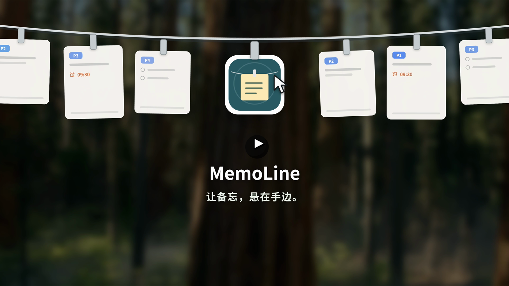

# MemoLine

留住小事，腾出心思。原生 macOS 菜单栏短便签应用：把to-do list像便利贴一样夹在屏幕顶部的绳子上。

支持 macOS 14+，Swift 5.9+，AppKit + SwiftUI。完全本地运行，无账号、网络请求、分析 SDK 或云同步。应用不监听截图、录屏或剪贴板，不需要屏幕录制或辅助功能授权。

## 使用演示

[](https://github.com/user-attachments/assets/0e38bbce-d4c8-4288-82d9-b235851cf0bc)

点击上方图片观看 30 秒使用演示。

## 下载与安装

1. 在 GitHub Releases 下载与 Mac 架构对应的 `MemoLine-*-macOS-*.zip` 和 `SHA256SUMS.txt`。
2. 可选：在终端进入下载目录，执行 `shasum -a 256 -c SHA256SUMS.txt` 验证文件。
3. 解压后把 `MemoLine.app` 拖入“应用程序”文件夹。
4. 尝试打开 MemoLine。当前 GitHub 构建未使用 Developer ID 签名且未经 Apple 公证；如果 macOS 阻止打开，请前往“系统设置 → 隐私与安全性”，仅在确认文件来自本仓库且校验值正确后选择“仍要打开”。
5. 首次成功启动会自动展开绳子数秒，点击“新建便签”即可开始。

未公证版本的完整安装和发布说明见 [1.10 发布记录](Documentation/RELEASE_NOTES_1.10.md)。

## 从源码运行

```sh
cd MemoLine
bash scripts/build-app.sh
open build/MemoLine.app
```

需要 Xcode 或 Apple Command Line Tools（`xcode-select --install`）。本地应用为 ad-hoc 签名，不包含 Developer ID 签名或公证。默认构建当前 Mac 的架构。菜单栏显示紧凑的系统便签图标，点击打开原生菜单；悬停可看到 MemoLine 名称。菜单最底部有 **退出 MemoLine**。启动后只保留菜单栏、便签绳和卡片，不弹出额外的便签管理窗口；在 Finder 再次打开应用时会显示绳子。

回归测试：

```sh
bash scripts/test.sh
```

测试使用独立 Swift 可执行目标 `MemoCoreTests`，不依赖 XCTest 或第三方库，兼容仅安装 Command Line Tools 的环境；失败时返回非零状态。`swift test` 不用于此仓库。

## 使用

- **鼠标新建**：点击菜单栏便签图标 → “新建便签”；或展开绳子，点击“＋ 新建第一张便签” / 右下方“＋ 新建便签”。无需使用快捷键。
- 新建时直接打开暖白纸卡，卡片内可输入正文、切换短文本/多项待办、设置优先级、置顶和提醒。点击“挂上便签”或 ⌘ Return 保存，Escape 取消未保存草稿。首次设置的提醒随便签一起保存后才调度通知。

- **Control + Option + N**：打开新建窗口，立即输入；**Command + Return** 保存并挂到绳子；**Escape** 放弃尚未保存的新便签。
- **Control + Option + T**：显示或隐藏绳子，可在菜单栏修改或停用；快捷键冲突时显示错误并恢复此前设置。
- 默认自动收起：在菜单栏顶部停留约 0.3 秒展开，离开约 0.6 秒后收起。菜单中的“常驻显示”可一直显示；在常驻模式手动隐藏后，再按快捷键或切换模式可恢复。
- 选择“隐藏便签绳”后，本次运行内暂停顶部悬停展开。选择“显示便签绳”、按显隐快捷键、切换显示模式或主动保存便签可恢复显示；到期提醒仍可临时展开目标便签。
- 统一暖白纸面、细纤维纹理、浅褶皱与柔和阴影。左上角为五阶蓝色 P1–P5 优先级标签，可点击修改，默认 P3；置顶用灰色图钉，提醒使用橙色。底部并列闹钟、垃圾桶和编辑按钮。
- 绳子左右两端分别提供撤销删除和新建便签。点击橙色闹钟直接弹出日期时间设置；点击 P 标签弹出优先级选择。点击笔图标或双击卡片正文，在卡片原位置直接输入，停止输入 0.4 秒后自动保存；点击“完成”、⌘ Return 或 Escape 结束编辑。点击其他位置失去输入焦点时，成功保存后自动收起输入区。清空、超限和保存失败时保留输入内容供修正。
- 单击选中；双击编辑；右键设置优先级、置顶、完成或删除。待办按项勾选，勾完最后一项后整张便签掉落移除，可撤销；垃圾桶直接删除整张便签。
- 便签掉落时播放轻微的系统废纸篓音效；系统音效不可用时使用 Pop 音效。可在菜单栏“显示方式 → 删除音效”关闭。
- 水平拖动卡片，在同一置顶分组内排序；滚轮或触控板滑动查看超出屏幕的便签。所有便签都保留在数据层，没有容量淘汰。
- 菜单栏“大小”可在大、中、小三种全局卡片规格间切换；小卡片同步收紧间距，让同一块屏幕容纳更多便签，设置会自动记住。
- 编辑已有便签时，停止输入 0.4 秒后自动保存。编辑窗口关闭前再次保存；失败时保留窗口与正文并显示原因。
- 正文 1–500 个 Unicode 字符；超限内容留在编辑器供修正，不静默截断。待办编辑器中每行一个任务，Return 添加下一项；卡片内可上下滚动并逐项勾选。修改文字时，内容未变的任务保留完成状态；新增或修改内容的任务默认未完成。提醒按整张便签设置。
- 普通删除和待办完成不再弹出确认，可从绳子上方或菜单栏“撤销删除”。撤销记录与便签一起持久化，重启后仍有效，可连续撤销多次删除；明确选择“永久删除…”时仍需二次确认。旧版已归档的便签会在首次升级启动时恢复到绳子，不会丢失。
- 每张便签可从编辑窗口、卡片闹钟按钮或右键菜单设置单次提醒：今天稍后、明天 09:00 或指定时间。第一次设置时才申请 macOS 通知权限；拒绝后，应用仍会在运行期间提醒并说明限制。
- 到点后只有对应卡片轻微抖动并显示红色边框，同时循环播放一份原创雷达式电子脉冲音；开启“减少动态效果”时不抖动。单击卡片只停止这一条提醒，不会完成待办；可再选择完成、编辑或稍后 10/30/60 分钟、明天提醒。多个提醒同时到期也只播放一份声音。应用完全退出时，系统通知仍使用 macOS 默认通知音。
- 系统通知提供“停止提醒”“10 分钟后提醒”“标记完成”。完成和删除都会取消关联通知。应用重启会恢复未来提醒，并将已经到期且未确认的提醒恢复为待确认状态。

## 数据和恢复

便签位于：

```
~/Library/Application Support/MemoLine/memos.json
~/Library/Application Support/MemoLine/memos.json.backup
```

JSON schema 4 自动读取旧版 schema 1–3；新增独立优先级和带稳定 UUID 的多项待办。旧便签默认 P3，旧待办整体迁移为一个任务，正文不丢失。旧版应用不应重新打开升级后的数据。写入采用原子替换；每次写入之前保留上一份完整快照。设置独立保存在 `local.memoline.desktop` 的 UserDefaults 中，便签数据不会写入 UserDefaults。

写入失败时，Store 不发布未落盘的状态，编辑器保留待保存文字。不要在错误仍未处理时强制退出。读取损坏文件或未知版本时，应用停止写入并提示，不用空数据覆盖原文件。

恢复步骤：退出应用；复制 `memos.json` 和 `.backup` 到安全位置；确认备份是有效 JSON 后，用备份副本替换 `memos.json`；重新启动。备份只保留上一快照，不是完整历史；可配合 Time Machine。数据不加密，受当前 macOS 用户账户和 FileVault 保护。不要同时运行多个源码启动的实例，也不要运行时手工修改数据文件。

## 架构

| 模块 | 职责 |
| --- | --- |
| `MemoCore/Memo` | 稳定 UUID、正文、类型、优先级、多项待办、状态、提醒与排序 |
| `MemoCore/MemoStore` | 校验、增删改查、提醒状态、排序、原子持久化、备份和失败反馈 |
| `MemoLineView` / `HangingMemoView` | 绳子布局、可读卡片、动效、选择与拖动 |
| `PaperSurface` / `PriorityBadge` | 原生绘制的纸张纤维与浅褶皱、五阶蓝色标签 |
| `LinePanel` / `LineState` | 不可成为 Key/Main 的悬浮窗口、显示状态与命中区域 |
| `MemoEditorWindowController` | 独立 NSWindow + NSTextView、键盘焦点、自动保存、退出保护 |
| `AppDelegate` | 菜单栏、快捷键、鼠标屏幕定位、窗口和焦点协调 |
| `Preferences` / `HotKey` | 显示模式、全屏设置和 Carbon 全局快捷键 |
| `ReminderController` / `ReminderUI` | 本地通知、到期恢复、单实例循环声音、稍后提醒和日期入口 |
| `Brand` / `scripts/make-icon.swift` | 新的菜单栏和应用图标 |

窗口空白区域通过命中区域和 `ignoresMouseEvents` 放行鼠标；整条绳子永不获得键盘焦点。只有编辑或标准窗口会激活应用，编辑关闭时恢复之前的应用。

尊重“减少动态效果”：关闭滑入、下落、悬停缩放、微风、提醒抖动和删除掉落动画；保留静态轻微倾斜。深色模式仍使用暖白不透明纸面和深色文字；已完成项使用删除线。纹理静态绘制，不依赖图片或后台计时器。

## 来源与许可证

基于 [Tendedero](https://github.com/alejandrobujan/tendedero) 的 MIT 开源代码改造，原作者 Alejandro Buján。MemoLine 是独立衍生项目，不是官方版本，也未获得原作者背书。

完整原始许可证保存在 [LICENSE](LICENSE)，MemoLine 新增代码的 MIT 许可见 [LICENSE-MEMOLINE](LICENSE-MEMOLINE)，署名和来源记录见 [THIRD_PARTY_NOTICES.md](THIRD_PARTY_NOTICES.md)，应用“关于”也提供署名及许可证入口。未使用上游名称、图标和文档图片作为产品品牌。Bundle Identifier：`local.memoline.desktop`。隐私说明见 [PRIVACY.md](PRIVACY.md)。

详细实施与验收记录见 [Documentation/IMPLEMENTATION.md](Documentation/IMPLEMENTATION.md) 和 [Documentation/VALIDATION.md](Documentation/VALIDATION.md)。

默认全屏保护还使用公开的 CGWindowList 窗口几何元数据，检测前台应用是否有窗口覆盖目标显示器；不读取窗口标题或屏幕像素，不需要录屏权限。此保守策略可能把隐藏菜单栏的最大化窗口也视作全屏。关闭“允许覆盖全屏应用”时，这些窗口也会让绳子收起。
